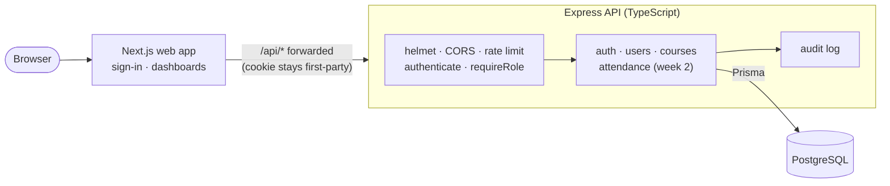

# Smart Campus Management System

[](https://github.com/kasondebbuku-spec/smart-campus-management/actions/workflows/ci.yml)

**A university platform for students, lecturers and administrators: accounts, courses, enrolment and (next) QR-code attendance with early warnings.**

Many university classes still take attendance on paper. Sheets get lost, friends sign for each other, and students learn they've fallen below the attendance requirement only when it's too late. Smart Campus keeps one trustworthy attendance record per student per class and shows everyone the part they're allowed to see.

> **Status: week 2 of 3.** Done: authentication, roles, users, courses, enrolment, class sessions with clash detection, rotating QR check-in, manual attendance marking, attendance rosters, audit logging, interactive OpenAPI docs, and a Next.js web app with sign-in and role-aware dashboards, with 130 tests. Next: lecturer and student screens for attendance, then deployment. See the [roadmap](#roadmap).

## Who it's for

| Role | Can |
|---|---|
| **Admin** | Create accounts, create courses, assign lecturers, enrol students, deactivate accounts, review the audit log |
| **Lecturer** | See the courses they teach and their class lists; run attendance (week 2) |
| **Student** | See the courses they're enrolled in; check in to class (week 2) |

## Highlights

- **Secure sessions.** 15-minute access tokens plus refresh tokens in `httpOnly` cookies. Refresh tokens are stored only as hashes, and each one works once. If an old one is replayed, the whole session is revoked. See the [auth design](docs/architecture.md#authentication-design).
- **Role-based access control.** Enforced in middleware and in the queries themselves: a lecturer's query can only ever match their own courses. Courses you can't see return 404, not 403.
- **Safe sessions in the browser.** The web app keeps the access token in memory only (never `localStorage`), and the refresh cookie is `httpOnly`, so page scripts can't read either. Many requests that expire together share one refresh, and two tabs refreshing at the same moment don't trip the theft detection.
- **Instant deactivation.** Disabling an account signs that person out everywhere immediately.
- **Audit trail.** Sign-ins, failed sign-ins, token theft detection, account and course changes are recorded with who, what and when.
- **Database-enforced integrity.** Unique enrolments and attendance records, transactions for multi-step changes.
- **QR check-in that can't be shared.** The code on the lecturer's screen changes every 30 seconds and is signed by the server, so a photo sent to a friend stops working within a minute. Nothing is stored per code: the server recomputes and checks the signature. See [how it works](docs/architecture.md#qr-check-in).
- **Timetable clash detection.** A course can't have two overlapping sessions, and a venue can't be double-booked across courses.
- **Consistent API errors.** Every error looks like `{ error: { code, message, details? } }`, with field-level validation messages.
- **Tested against a real database.** Unit tests plus HTTP integration tests run against PostgreSQL in CI on every pull request.

## Architecture



More detail:
- [Requirements](docs/requirements.md): problem, users, functional and non-functional requirements
- [Architecture](docs/architecture.md): request lifecycle, auth sequence diagram, technology choices
- [Database design](docs/database-design.md): ER diagram, constraints, indexes and why

## API

Base URL: `/api/v1`

| Method | Path | Who | Purpose |
|---|---|---|---|
| `POST` | `/auth/login` | anyone | Sign in; returns an access token and sets the refresh cookie |
| `POST` | `/auth/refresh` | cookie | New access token; rotates the refresh token |
| `POST` | `/auth/logout` | cookie | Revoke the session |
| `GET` | `/auth/me` | signed in | Current user and profile |
| `POST` | `/users` | admin | Create a student, lecturer or admin |
| `GET` | `/users?role=&search=&page=&pageSize=` | admin | Search and paginate users |
| `GET` | `/users/:id` | admin | One user |
| `POST` | `/users/:id/deactivate` | admin | Disable an account and sign it out everywhere |
| `GET` | `/courses` | signed in | Courses visible to you |
| `GET` | `/courses/:id` | signed in | One course, if visible to you |
| `POST` | `/courses` | admin | Create a course |
| `POST` | `/courses/:id/enrolments` | admin | Enrol students (repeat enrolments are skipped) |
| `GET` | `/courses/:id/students` | admin, course lecturer | Class list |
| `POST` | `/courses/:id/sessions` | admin, course lecturer | Schedule a class session (rejects course and venue clashes) |
| `GET` | `/courses/:id/sessions?from=&to=` | anyone who can see the course | Timetable for the course |
| `GET` | `/sessions/:id` | anyone who can see the course | One session |
| `PATCH` | `/sessions/:id` | admin, course lecturer | Move or re-room a session (audited with the old values) |
| `DELETE` | `/sessions/:id` | admin, course lecturer | Delete a session that has no attendance yet |
| `POST` | `/sessions/:id/check-in/open` | admin, course lecturer | Open QR check-in (`durationMinutes`, `lateAfterMinutes`) |
| `GET` | `/sessions/:id/check-in/qr` | admin, course lecturer | Current QR code and seconds until it changes |
| `POST` | `/sessions/:id/check-in/close` | admin, course lecturer | Close check-in |
| `POST` | `/check-in` | student | Scan a QR code; records PRESENT or LATE |
| `GET` | `/sessions/:id/attendance` | admin, course lecturer | Every enrolled student's status, plus a summary |
| `PUT` | `/sessions/:id/attendance` | admin, course lecturer | Mark or correct several students at once (audited old → new) |
| `POST` | `/sessions/:id/attendance/mark-absent` | admin, course lecturer | Mark everyone without a record ABSENT (after check-in closes) |
| `GET` | `/health` | anyone | Liveness and database check |

**Interactive docs:** run the API and open [`/api/docs`](http://localhost:4100/api/docs) to browse every endpoint and try it out. Sign in with `POST /auth/login`, click **Authorize**, and paste the access token. The raw OpenAPI 3.1 spec is at `/api/docs/openapi.json`.

A test reads the route files and fails if any endpoint is missing from the docs, or the docs describe one that doesn't exist, so the two can't drift apart.

## Testing

```bash
npm test
```

- **Unit tests**: access token signing and verification, tampered and forged tokens, `alg: none`, expiry, refresh token hashing, QR token rotation and signatures
- **Web app tests**: the API client attaches tokens, refreshes once and retries, shares one refresh between concurrent requests, retries a two-tab race, signs out when refresh fails; the sign-in redirect refuses other sites (`//host`, `/\host`, control characters)
- **Integration tests** (Supertest against PostgreSQL):
  - login, cookie flags, identical errors for unknown email and wrong password, rate limiting
  - refresh rotation, theft detection, two tabs refreshing at once (no false alarm), expiry, logout
  - admin-only user management, validation messages, duplicates, no half-created users, immediate deactivation
  - course visibility for each role, 404 for hidden courses, enrolment that's safe to repeat, class list permissions
  - class sessions: who can schedule, time validation, course and venue clash detection, back-to-back bookings, date filters, protected deletion
  - QR tokens: 30-second rotation, one period of grace, expiry, forged and copied signatures, malformed input
  - check-in: on time vs late, closed check-in, not enrolled, double and simultaneous scans, hand-marked records never overwritten, roster summary
  - API docs: every route documented and nothing extra, path parameters declared, no broken references, docs page served under a nonce-based security policy
  - manual marking: batch create and correct, old and new status audited, no-op changes not logged, all-or-nothing batches, EXCUSED-only before class, mark-absent safe to repeat

Integration tests use `TEST_DATABASE_URL` and are skipped when it isn't set. CI runs type checks, lint, all tests and the build on every push and pull request: [`.github/workflows/ci.yml`](.github/workflows/ci.yml).

## Run it locally

**Requirements:** Node 20+ and PostgreSQL (or Docker).

```bash
git clone https://github.com/kasondebbuku-spec/smart-campus-management.git
cd smart-campus-management
docker compose up -d                 # PostgreSQL with smart_campus and smart_campus_test
cp apps/api/.env.example apps/api/.env
# set JWT_ACCESS_SECRET and SEED_ADMIN_PASSWORD in apps/api/.env
npm install
npm run db:migrate                   # create the tables
npm run db:seed                      # admin, 2 lecturers, 5 students, 2 courses
npm run dev:api                      # API on http://localhost:4000
npm run dev:web                      # web app on http://localhost:3000 (in a second terminal)
```

Open http://localhost:3000 and sign in as `admin@campus.test` with your `SEED_ADMIN_PASSWORD`. The demo lecturers (`m.phiri@campus.test`, `c.banda@campus.test`) and students (for example `natasha.mwila@campus.test`) use the same password. If the API runs on another port, set `API_URL` in `apps/web/.env`.

Or call the API directly:

```bash
curl -s -X POST localhost:4000/api/v1/auth/login \
  -H "Content-Type: application/json" \
  -d '{"email":"admin@campus.test","password":"<SEED_ADMIN_PASSWORD>"}'
```

## Project structure

```
apps/api/
  prisma/schema.prisma        data model
  prisma/migrations/          versioned schema changes
  prisma/seed.ts              demo data
  src/app.ts                  Express app: middleware and routes
  src/config.ts               environment variables, validated at startup
  src/middleware/auth.ts      authenticate and requireRole
  src/modules/auth/           login, refresh rotation, logout
  src/modules/users/          admin user management
  src/modules/courses/        courses, enrolment, class lists, access rules
  src/modules/sessions/       class sessions and clash detection
  src/modules/attendance/     QR check-in, manual marking and rosters
  src/lib/qr-token.ts         rotating signed QR codes
  src/openapi/                OpenAPI spec and the /api/docs page
  src/lib/                    tokens, audit log, error handling
  tests/                      unit and integration tests
apps/web/
  src/lib/api.ts              API client: tokens in memory, one shared refresh, race retry
  src/lib/auth.tsx            sign-in state for the whole app
  src/lib/redirect.ts         safe "go back to where you were" after sign-in
  src/app/login/              sign-in page
  src/app/dashboard/          role-aware dashboard
  tests/                      unit tests
packages/shared/              types and constants shared with the web app
docs/                         requirements, architecture, database design
```

## Roadmap

- [x] **Week 1: foundation.** Requirements, architecture, database design, auth with refresh rotation, roles, users, courses, enrolment, audit log, tests, CI
- [ ] **Week 2: attendance and web app.** ~~Class sessions~~ ✅, ~~rotating QR check-in~~ ✅, ~~manual marking~~ ✅, ~~OpenAPI docs~~ ✅, ~~web app with sign-in and dashboard~~ ✅, lecturer check-in screen and student check-in
- [ ] **Week 3: reports and launch.** Attendance analytics, low-attendance warnings, CSV and PDF export, end-to-end tests with Playwright, Docker deployment, live demo

## Author

**Kasonde Bbuku**, BSc Computer Science (Software Engineering), University of Zambia
GitHub: [@kasondebbuku-spec](https://github.com/kasondebbuku-spec)

Licensed under the [MIT License](LICENSE).
