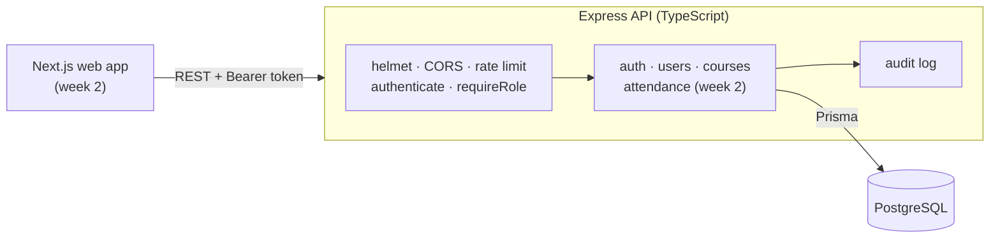

# Smart Campus Management System

[](https://github.com/kasondebbuku-spec/smart-campus-management/actions/workflows/ci.yml)

**A university platform for students, lecturers and administrators: accounts, courses, enrolment and (next) QR-code attendance with early warnings.**

Many university classes still take attendance on paper. Sheets get lost, friends sign for each other, and students learn they've fallen below the attendance requirement only when it's too late. Smart Campus keeps one trustworthy attendance record per student per class and shows everyone the part they're allowed to see.

> **Status: week 1 of 3.** The API foundation is done: authentication, roles, users, courses, enrolment and audit logging, with 40 tests. Attendance, the web app and deployment come next. See the [roadmap](#roadmap).

## Who it's for

| Role | Can |
|---|---|
| **Admin** | Create accounts, create courses, assign lecturers, enrol students, deactivate accounts, review the audit log |
| **Lecturer** | See the courses they teach and their class lists; run attendance (week 2) |
| **Student** | See the courses they're enrolled in; check in to class (week 2) |

## Highlights

- **Secure sessions.** 15-minute access tokens plus refresh tokens in `httpOnly` cookies. Refresh tokens are stored only as hashes, and each one works once. If an old one is replayed, the whole session is revoked. See the [auth design](docs/architecture.md#authentication-design).
- **Role-based access control.** Enforced in middleware and in the queries themselves: a lecturer's query can only ever match their own courses. Courses you can't see return 404, not 403.
- **Instant deactivation.** Disabling an account signs that person out everywhere immediately.
- **Audit trail.** Sign-ins, failed sign-ins, token theft detection, account and course changes are recorded with who, what and when.
- **Database-enforced integrity.** Unique enrolments and attendance records, transactions for multi-step changes.
- **Consistent API errors.** Every error looks like `{ error: { code, message, details? } }`, with field-level validation messages.
- **Tested against a real database.** Unit tests plus HTTP integration tests run against PostgreSQL in CI on every pull request.

## Architecture



More detail:
- [Requirements](docs/requirements.md): problem, users, functional and non-functional requirements
- [Architecture](docs/architecture.md): request lifecycle, auth sequence diagram, technology choices
- [Database design](docs/database-design.md): ER diagram, constraints, indexes and why

## API

Base URL: `/api/v1`

| Method | Path | Who | Purpose |
|---|---|---|---|
| `POST` | `/auth/login` | anyone | Sign in; returns an access token and sets the refresh cookie |
| `POST` | `/auth/refresh` | cookie | New access token; rotates the refresh token |
| `POST` | `/auth/logout` | cookie | Revoke the session |
| `GET` | `/auth/me` | signed in | Current user and profile |
| `POST` | `/users` | admin | Create a student, lecturer or admin |
| `GET` | `/users?role=&search=&page=&pageSize=` | admin | Search and paginate users |
| `GET` | `/users/:id` | admin | One user |
| `POST` | `/users/:id/deactivate` | admin | Disable an account and sign it out everywhere |
| `GET` | `/courses` | signed in | Courses visible to you |
| `GET` | `/courses/:id` | signed in | One course, if visible to you |
| `POST` | `/courses` | admin | Create a course |
| `POST` | `/courses/:id/enrolments` | admin | Enrol students (repeat enrolments are skipped) |
| `GET` | `/courses/:id/students` | admin, course lecturer | Class list |
| `GET` | `/health` | anyone | Liveness and database check |

An OpenAPI specification is on the roadmap.

## Testing

```bash
npm test
```

- **Unit tests**: token signing and verification, tampered and forged tokens, `alg: none`, expiry, refresh token generation and hashing
- **Integration tests** (Supertest against PostgreSQL):
  - login, cookie flags, identical errors for unknown email and wrong password, rate limiting
  - refresh rotation, theft detection, simultaneous refreshes, expiry, logout
  - admin-only user management, validation messages, duplicates, no half-created users, immediate deactivation
  - course visibility for each role, 404 for hidden courses, enrolment that's safe to repeat, class list permissions

Integration tests use `TEST_DATABASE_URL` and are skipped when it isn't set. CI runs type checks, lint, all tests and the build on every push and pull request: [`.github/workflows/ci.yml`](.github/workflows/ci.yml).

## Run it locally

**Requirements:** Node 20+ and PostgreSQL (or Docker).

```bash
git clone https://github.com/kasondebbuku-spec/smart-campus-management.git
cd smart-campus-management
docker compose up -d                 # PostgreSQL with smart_campus and smart_campus_test
cp apps/api/.env.example apps/api/.env
# set JWT_ACCESS_SECRET and SEED_ADMIN_PASSWORD in apps/api/.env
npm install
npm run db:migrate                   # create the tables
npm run db:seed                      # admin, 2 lecturers, 5 students, 2 courses
npm run dev:api                      # http://localhost:4000
```

Try it:

```bash
curl -s -X POST localhost:4000/api/v1/auth/login \
  -H "Content-Type: application/json" \
  -d '{"email":"admin@campus.test","password":"<SEED_ADMIN_PASSWORD>"}'
```

## Project structure

```
apps/api/
  prisma/schema.prisma        data model
  prisma/migrations/          versioned schema changes
  prisma/seed.ts              demo data
  src/app.ts                  Express app: middleware and routes
  src/config.ts               environment variables, validated at startup
  src/middleware/auth.ts      authenticate and requireRole
  src/modules/auth/           login, refresh rotation, logout
  src/modules/users/          admin user management
  src/modules/courses/        courses, enrolment, class lists
  src/lib/                    tokens, audit log, error handling
  tests/                      unit and integration tests
packages/shared/              types and constants shared with the web app
docs/                         requirements, architecture, database design
```

## Roadmap

- [x] **Week 1: foundation.** Requirements, architecture, database design, auth with refresh rotation, roles, users, courses, enrolment, audit log, tests, CI
- [ ] **Week 2: attendance and web app.** Class sessions, rotating QR check-in, manual marking, Next.js dashboards for each role, OpenAPI docs
- [ ] **Week 3: reports and launch.** Attendance analytics, low-attendance warnings, CSV and PDF export, end-to-end tests with Playwright, Docker deployment, live demo

## Author

**Kasonde Bbuku**, BSc Computer Science (Software Engineering), University of Zambia
GitHub: [@kasondebbuku-spec](https://github.com/kasondebbuku-spec)

Licensed under the [MIT License](LICENSE).
