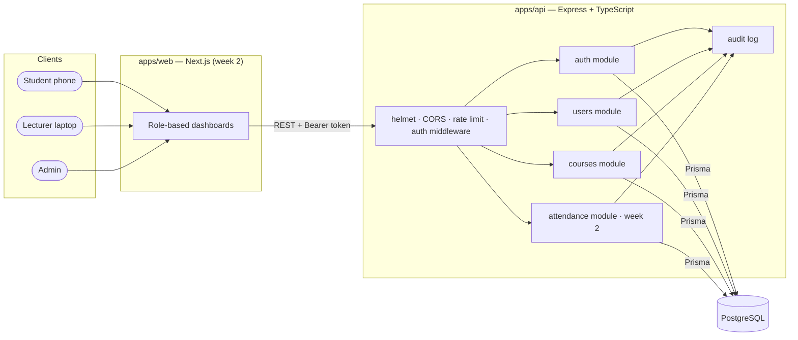
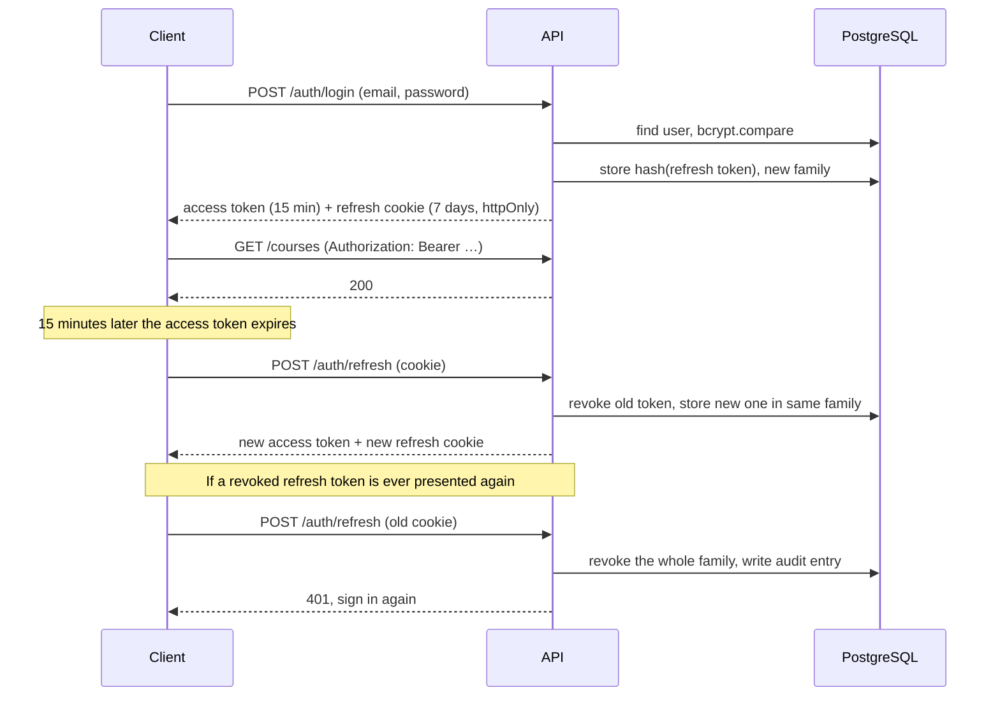

# Architecture

## Overview



The repository is an npm-workspaces monorepo:

```
apps/api          REST API (Express 5, TypeScript, Prisma)
apps/web          Next.js front end (week 2)
packages/shared   types and constants used by both
docs/             requirements, architecture, database design
```

The API and web app are separate so the API can also serve a mobile app later, and so each can be deployed and scaled on its own.

## Request lifecycle

1. **helmet** sets security headers; **CORS** only allows the web app's origin to send cookies.
2. **authenticate** checks the Bearer token's signature and expiry, then loads the user to confirm the account is still active.
3. **requireRole** rejects roles that may not use the route (403).
4. The route handler **validates the body with Zod**. Invalid input never reaches the database.
5. Queries are **scoped to the user** (a lecturer's query only matches their own courses), so a missing check can't leak another course's data.
6. Data-changing actions write an **audit log** entry, inside the same transaction where it matters.
7. One **error handler** turns every error into `{ error: { code, message, details? } }`.

## Authentication design



| Choice | Reason |
|---|---|
| **Short-lived access token** (JWT, 15 min) in memory | Stateless and fast to check; a stolen one stops working quickly |
| **Refresh token** in an `httpOnly`, `SameSite=Strict` cookie scoped to `/api/v1/auth` | Page scripts can't read it, so an XSS bug can't steal it; it's only sent to the auth routes |
| Refresh tokens **stored as SHA-256 hashes** | A leaked database backup can't be used to sign in |
| **Rotation with reuse detection** | Each refresh token works once. Reuse means it was copied, so the whole session family is revoked |
| Access check **loads the user on every request** | Deactivating an account takes effect immediately, not after 15 minutes |
| **Same error** for unknown email and wrong password, and a dummy bcrypt compare | Attackers can't find out which emails are registered |
| **Rate limit** on login | Slows down password guessing |

## Technology choices

| Technology | Why |
|---|---|
| TypeScript | Catches whole classes of bugs at compile time; shared types between API and web |
| Express 5 | Small, well understood, and handles errors thrown in async handlers natively |
| PostgreSQL | Relational data with real constraints (unique enrolments, foreign keys) and transactions |
| Prisma | Type-safe queries and versioned migrations |
| Zod | One schema both validates input and gives the TypeScript type |
| Vitest + Supertest | Fast unit tests and HTTP-level integration tests against a real database |
| Docker Compose | Anyone can start the database with one command |
| GitHub Actions | Every pull request is type-checked, linted, tested and built |
