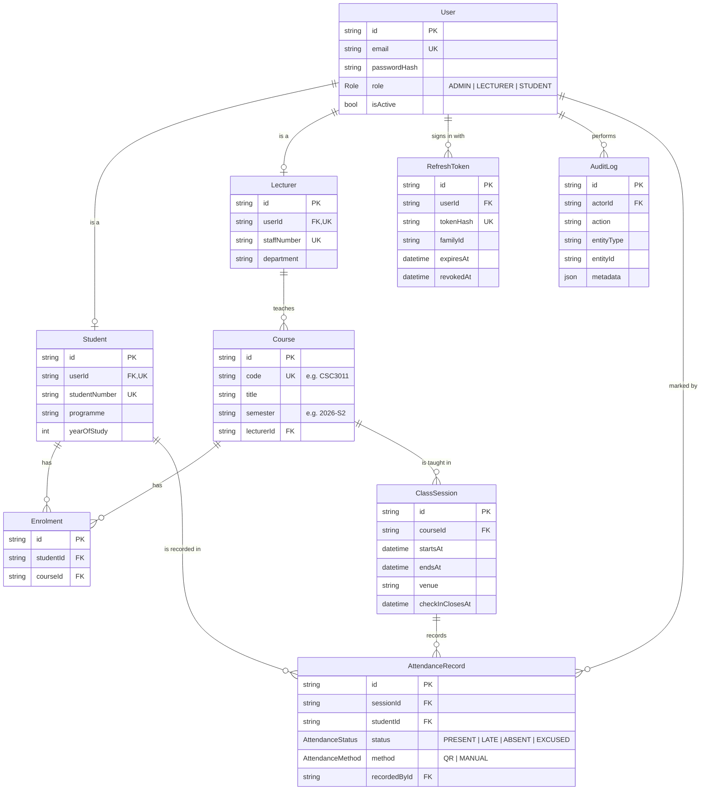

# Database design

Schema source: [`apps/api/prisma/schema.prisma`](../apps/api/prisma/schema.prisma). Migrations: [`apps/api/prisma/migrations`](../apps/api/prisma/migrations).

## Entity relationship diagram

## Design decisions

**One `User` table plus profile tables.** Every person signs in the same way, so login, roles and sessions live in `User`. Student-only fields (student number, programme) and lecturer-only fields (staff number, department) live in `Student` and `Lecturer`, linked one-to-one. This avoids a single wide table full of empty columns, and lets a query ask for "students" without filtering by role.

**Rules enforced by the database, not only the code.**

| Rule | Constraint |
|---|---|
| A student is enrolled in a course at most once | `UNIQUE (studentId, courseId)` on `Enrolment` |
| One attendance record per student per session | `UNIQUE (sessionId, studentId)` on `AttendanceRecord` |
| Emails, student numbers, staff numbers and course codes are unique | `UNIQUE` on each column |
| A refresh token hash appears once | `UNIQUE (tokenHash)` |

Two requests racing each other can both pass a check in code, but only one can pass a unique constraint.

**Deletion behaviour.**
- Deleting a user removes their profile and sessions (`CASCADE`).
- Removing a lecturer leaves their courses in place with no lecturer (`SET NULL`), so history isn't lost.
- Audit entries keep their content if the actor is deleted (`SET NULL` on `actorId`).

**Indexes follow the queries.**
- `Enrolment(courseId)` for class lists.
- `ClassSession(courseId, startsAt)` for a course's timetable.
- `AttendanceRecord(studentId)` for a student's record.
- `AuditLog(actorId, createdAt)` and `(action, createdAt)` for "what did this person do" and "all failed logins this week".

**Refresh token families.** Every login creates a `familyId`. Each refresh revokes the old token and issues a new one in the same family, linked by `replacedById`. If a revoked token is used again, every token in the family is revoked. See [architecture.md](architecture.md#authentication-design).

**Audit log is append-only.** The API only ever inserts into `AuditLog`. `metadata` is JSON so each action can carry its own details (for example `{ requested: 30, added: 28 }` for an enrolment) without schema changes.
